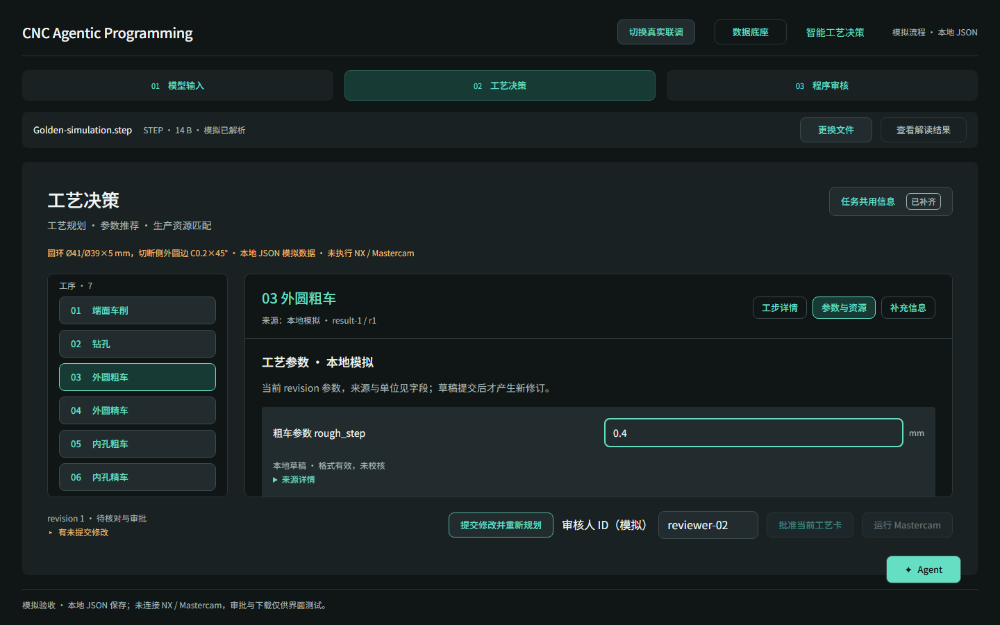
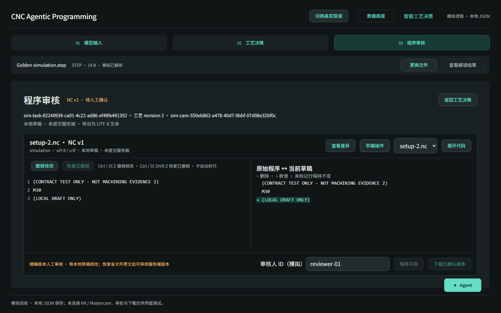
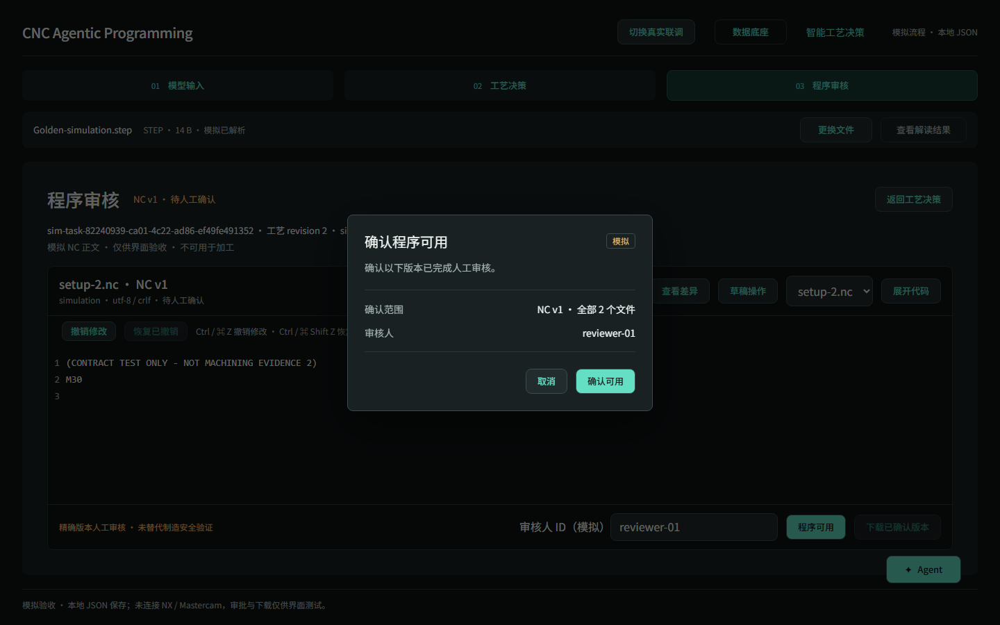
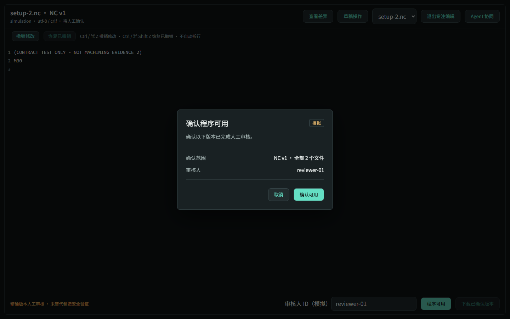

# PR30 交互保留排查与修复

日期：2026-10-26。基线 main / PR30：`29765fd`；原始 PR31：`65e7315`。修改分支：`fix/pr31-visual-polish`。不合并 main。

## 结论与来源

对照上述提交，`ProgramReviewPage.tsx` 在 PR30 与原始 PR31 之间没有变化。用户观察到的“查看差异消失”是真实问题，但原因是原型页面与 Live 页面原本存在能力差异：新完整模拟流程复用 Live 后，原型已有的交互没有同步过来。不能将这些问题全部归因于 PR31 删除功能。

本次按原型已确认的交互补齐 Live 与完整模拟页面；不把本地草稿、模拟执行、Agent 占位包装成真实后端能力。

## 本次修复

- **提交入口**：现场信息与加工参数共用“提交修改并重新规划”。同时修改时先提交现场信息并确认回读，再携带最新反馈版本和参数补丁发起一次重新规划。失败保留草稿，重试沿用命令 ID。工艺卡审批保持独立。无修改且没有待规划反馈时禁用，避免重复生成修订。
- **数值输入**：加工参数直接输入小数。保留受控允许值校验；当前 Golden rough_step 仍只允许 0.4、0.5 mm。非法输入不会提交现场信息或参数补丁。纠正输入后清理过时的校验提示。
- **来源展示**：上游参数的摘要、资源身份和 JSON 路径折叠到“来源详情”，原始数据仍可查看。模拟数据不再显示“Core 实际结果”。
- **代码差异**：恢复“查看差异”，复用原有逐行增删对比。原始 NC 与本地草稿对照，不伪造服务端历史版本。统一内部换行避免 CRLF 导致整篇假差异，导出保留源文件换行类型。
- **本地草稿**：打开正文即可直接编辑，无需切换编辑模式；保留撤销/重做、恢复原文、恢复暂存、保存和导出。辅助操作收进“草稿操作”，保持底部审批区域紧凑。导出明确命名 `.unapproved-draft.txt`，使用 UTF-8，不等同于已审批 NC 包。
- **修订记录**：本地修订号及最近 20 次操作记录放在草稿菜单内，记录编辑、暂存和恢复操作；与服务端审批记录区分。
- **状态隔离**：草稿按模拟/真实、任务、NC 身份、文件身份和摘要保存到本地 JSON。支持切换文件与重新进入后恢复。任一文件有本地修改，整版服务端 NC 的批准/下载入口暂时禁用，恢复各文件原文后重新开放。
- **展开与 Agent**：保留展开代码、Esc 返回及按钮焦点恢复；恢复展开视图里的 Agent 入口。Live 与完整模拟恢复完整上下文抽屉，可查看任务、NC、当前工序并切换工序；真实消息服务未接入，因此发送按钮明确禁用。旧原型的预设消息演示仍保留。
- **入口说明**：工步页的任务共用信息提示改为实际的右上角入口，旧原型仍保持左侧入口描述。

## 其他功能核查

- 模型选择、替换、示例加载、错误提示：保留；完整模拟额外提供受控示例和失败场景。真实上传、解析、恢复沿用原接口。
- 工序左选右看、工步/参数/补充信息切换、待填定位、局部滚动：保留；既有 Playwright 回归与两视口布局检查通过。
- NC 多文件切换、精确版本确认、服务端批准包下载：保留；本地草稿导出与批准包下载互不替代。
- 旧原型案例选择与参考程序编辑：保留，旧流程继续通过回归。
- 数据底座、导航、公共 Shell：继续共用既有实现，本次未替换这些页面。

## 仍属于未接入能力

- 真实 Agent 对话：PR30 Live 本就未接入。本次恢复抽屉交互，不生成虚假回复。
- “查看解读结果”的几何可视化：PR30 已是占位入口；现在仍明确提示尚未接入。
- 本地修改 NC 回传后端并形成新的可审核候选：当前前端未接入该协议。本次只提供本地草稿编辑、对比和导出，不能将草稿直接批准为原服务端候选。

## 验证与截图

`npm run quality` 通过，313 项单元测试通过。完整 Playwright 102/102 通过，覆盖 1920×1080 与 1440×900；后续细节调整另跑模拟、恢复及布局专项。测试覆盖参数/现场信息混合提交、越界输入、丢失回执恢复、跨文件草稿隔离、撤销/重做、差异、暂存/恢复、导出及展开 Agent。

无真实 NX / Mastercam 制造验证。自动化功能回归 PASS，等待人工体验。

截图目录：`simulation-evidence/chromium-1920x1080/`、`simulation-evidence/chromium-1440x900/`。

## 程序可用确认弹窗修正

按钮改为“程序可用”，确认按钮为“确认可用”，下载入口为“下载已确认版本”。确认后显示“程序可用 · 人工确认”，模拟模式显示“程序可用 · 模拟确认”。后台审批请求、精确版本比对与下载门禁保持原有语义。

弹窗复用深色对话框样式，440px 宽、视口居中，只显示版本/全部文件范围与审核人，不再铺开摘要。保留取消、Esc 关闭与返回触发按钮的焦点。普通/专注视图在 1920×1080、1440×900 均通过截图与几何检查。

本次验证：quality 通过（313 项单元测试），相关浏览器回归 56/56 通过，无重试。

