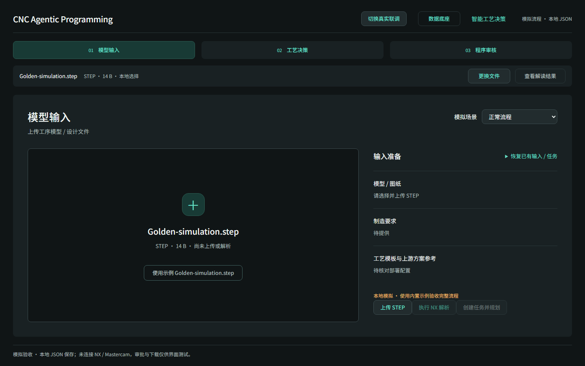
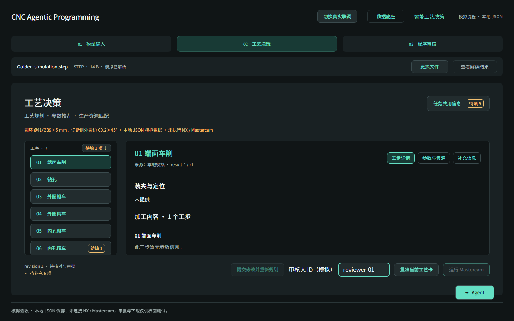
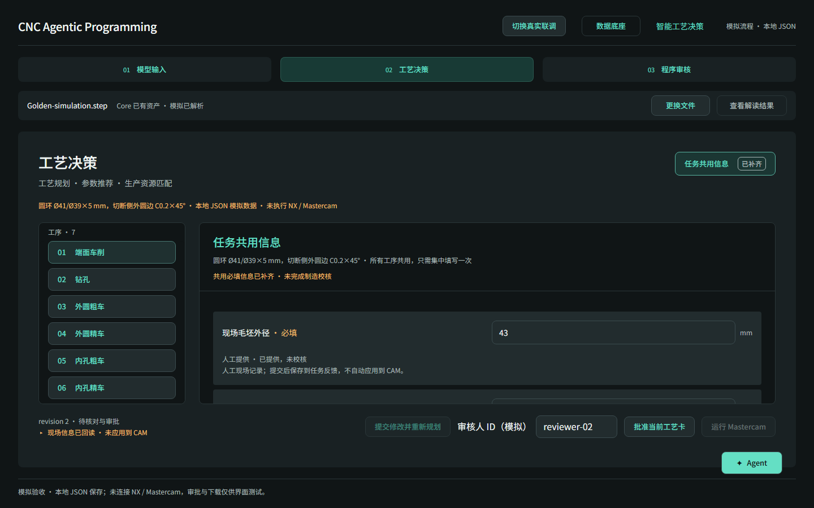
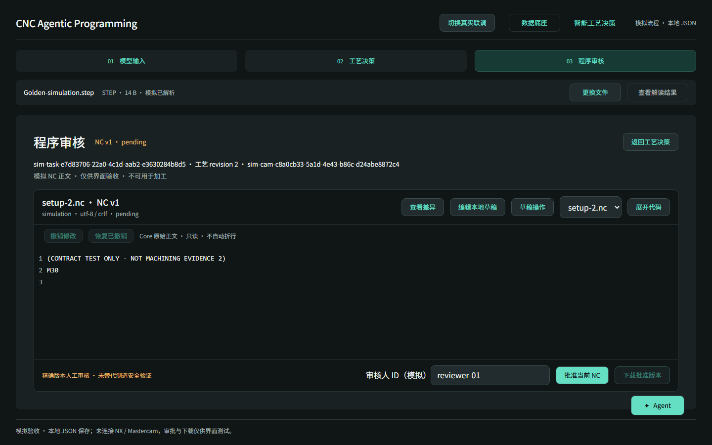

# PR31 模拟流程与真实页面共用验收

日期：2026-10-26。分支：`fix/pr31-visual-polish`。不合并 main。

最新交互补齐见 [PR30 功能排查记录](PR30-Interaction-Parity-Audit.md)：统一提交入口、数值输入、代码差异与本地草稿操作。

## 体验入口

启动开发服务器后，点击顶部“模拟完整流程”，或打开 `/?mode=simulation`。选择内置 Golden 示例 → 上传 STEP → 执行 NX 解析 → 查看工艺规划结果。审核人可填写 `reviewer-01`；这是声明 ID，不是登录或权限认证。

旧的 r06 原型案例入口继续保留。验收 PR31 新增功能请使用“模拟完整流程”，该入口共用真实联调的 `useLiveWorkflow`、模型输入、工艺决策和程序审核组件，只替换接口传输与部署配置来源。

## 已验证范围

- 审核人填写、工艺卡审批、NC 精确版本确认、多个 NC 文件切换及批准版本下载。
- 任务共用信息、工序现场信息填写、提交回读、刷新恢复和根据补充信息重新规划。
- 参数修订、重新审批、CAM 进度和 NC 只读审核。
- 自动恢复、按任务 ID 查询、未知 ID 错误；模拟与真实模式隔离。
- 模拟场景：正常、需补充信息后重新规划、NX 解析失败、CAM 执行失败。新任务采用创建时的场景；解析失败可切回正常场景重试。

真实接口路径、请求字段及后端实现未修改。新增可注入传输层，真实模式仍使用原有 fetch 与受控部署配置校验。审核人增加可读的 ASCII ID 校验提示，避免非法 HTTP Header 字符导致无法重试的异常。

## 数据与模拟边界

模拟任务、资产、命令回执、修订、反馈、审批人保存在浏览器 localStorage 的 `capptron.simulation.v1` JSON 中。审核人默认值保存为 `capptron.simulation.v1.reviewer` JSON。恢复日志使用独立 scope，和真实任务隔离。同一浏览器、同一站点地址刷新可恢复；换端口、换浏览器、清除站点数据不会共享记录。

使用具名合成 Fixture；只接受内置示例内容。未知接口直接报错，不向真实网络回退。NC 正文为合成文本，下载文件名为 `SIMULATION-ONLY.zip`，包含模拟声明及 NC 文件。不连接 NX、Mastercam，不代表制造验证、真实审批或加工许可。Agent 及数据底座沿用现有共用页面能力，不虚构真实模式尚未接入的能力。

## 验证结果

- `npm run quality`：通过，313 项单元测试通过。
- 完整 Playwright：102/102 通过，0 跳过、0 flaky。
- 最终场景选择器位置调整后，模拟流程和 Live 布局专项：12/12 通过。
- Chromium：1920×1080、1440×900。共 18 张模拟截图。
- 1440 输入页无额外页面纵向滚动；两视口无横向溢出。工序列表有效高度分别至少 450px、270px；补充信息回读后底部操作区不超过 56px。
- 模拟主流程断言没有 `/cad`、`/planning`、`/process-cards`、`/cam` 网络请求。
- 构建成功；Vite 提示主包大于 500kB，可后续按模式拆包，不影响本次功能验收。

结论：自动化验收 PASS，等待人工体验。不包含真实制造验收，也不表示原 PR31 已合入本分支修改。

## 截图

两个视口的截图分别在 `simulation-evidence/chromium-1920x1080/` 和 `simulation-evidence/chromium-1440x900/`。

1440×900 示例：

其余截图：`task-information.png`、`parse-error.png`、`cam-error.png`。
