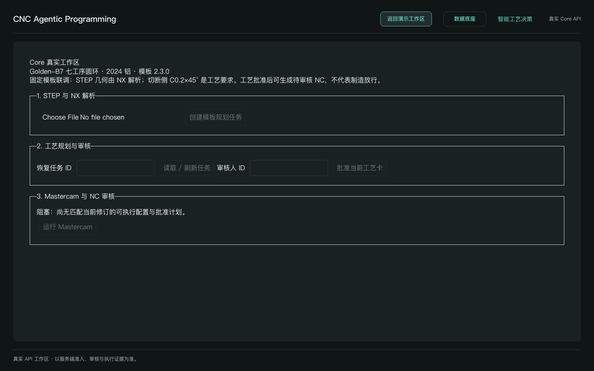
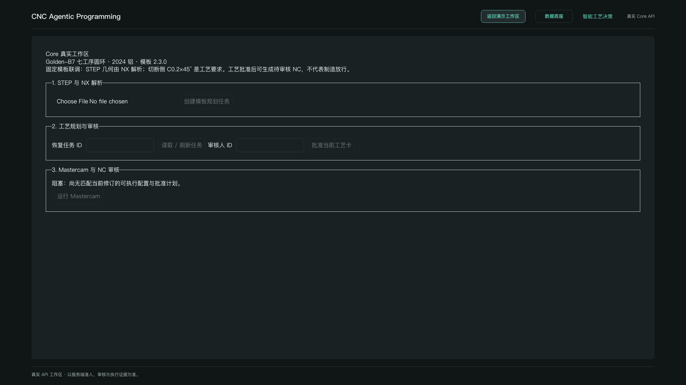
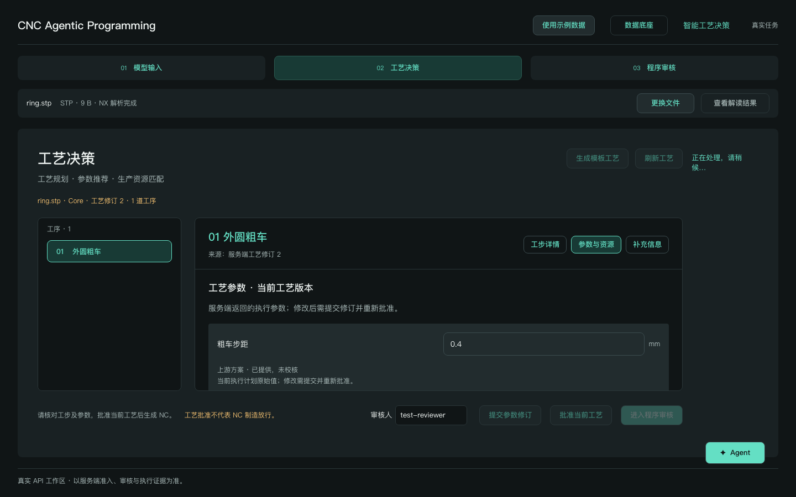
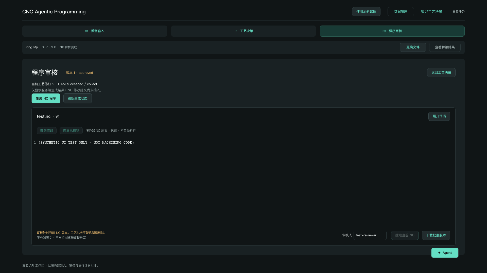

# 智能工艺决策主流程接线

配置 `VITE_API_BASE_URL` 后，直接在原型页面操作真实流程。保留 r06 文件选择区、文件信息条、输入准备、工序侧栏、工步/参数/补充信息切换及代码工作台。独立 Core 工作区已移除；“使用示例数据”仅切换隔离的示例模式。未配置 API 时默认示例模式，可切回真实流程使用同源代理。不要在 VITE 变量中放制造凭据。

手动测试步骤：选择或拖入 STEP → 右侧“上传模型” → “开始解析” → 刷新至解析完成 → “进入工艺决策” → “生成模板工艺”并刷新 → 在“参数与资源”修改粗车步距、提交修订 → 填写审核人并批准当前工艺 → 进入程序审核 → 生成 NC / 刷新生成状态 → 查看服务端正文。NC 批准与批准版本下载分别由后端控制。正常流程自动传递任务 ID；“恢复已有任务”为辅助折叠入口。


## 已接线

- 原始 STEP 二进制上传与存储回执；以 asset_id + command_id 触发/读取 NX 解析。
- 解析成功后创建 template-request-v1，绑定 source.asset_id/sha256/parse_command_id。
- 固定 golden-b7 2.3.0 七工序及 digest（来自 Core `load_integration_template()`）；请求只携带模板与真实解析回执身份，尺寸/特征由 Core 推导。
- 读取/恢复任务、生成模板、展示完整服务端计划和工艺卡；使用 current_revision/feedback_version/template_digest/plan_digest 提交 rough_step 修订。
- 工艺卡批准后，必须由 approved-plans 返回 execution_configured/profile_matches 且匹配当前 revision 才可发起 CAM。
- 工艺卡任务路径使用 Core 的 `id_` + UTF-8 base64url 编码。读取已有 CAM 运行，对 accepted/running 调用 observe，终态只读；读取所有候选 NC 文件、按完整 NcVersionRef 审核和下载。文件 ID 使用查询参数，保留斜线。

## 边界

工作区目前使用显式刷新。服务端回执与错误原样可检查。NX 解析报告不表示模板已获制造准入；无真实执行配置或匹配计划时按钮阻塞。没有成功回执时不要推断执行成功；可用任务 ID 和运行 ID 恢复查询。

本次实现不包含 NC 文本编辑或模型反馈修订。参数修改走工艺版本再审批再生成，不能在浏览器修改执行资格。工具链测试和请求替身只验证前端行为，不能替代真实 Windows/NX/Mastercam 验收。

## 2026-10-22 验证

`npm run quality` 通过（17 个测试文件，265 项测试，包含类型检查、Lint、格式和构建）。新增 Core 浏览器检查在 1920×1080 和 1440×900 两种视口共 6 项通过，覆盖真实模式隔离、上传失败不推进、旧批准版本不能启动当前 CAM。截图见 `core-live-evidence/`。

完整 Playwright：54 通过、4 失败。失败均为既有 `program-review.spec.ts` 的编辑器键盘/差异测试（108、208 行，各两视口）；在未修改的 main `35534d9` 独立快照中同样 4 项失败，未改动该编辑器。本机使用 Playwright Chromium 156/v1248。沙箱缺少 macOS MachPort 启动权限时需允许浏览器进程在沙箱外运行。

没有连接真实 Windows 后端，本记录不表示 NX、Mastercam、NC 或实际制造通过。

### 审核修复

补充跨任务刷新失败、规划 POST 响应丢失、终态与修订读取先后、NC 正文读取失败的保护。规划请求发出前冻结审核与 CAM；结果不确定时保留原请求，并通过刷新重用 command_id 恢复。当前任务快照全部读取成功后统一展示；NC 正文全部读取成功后才能审核。补充回归后 Core 双视口 E2E 共 12 项通过，`npm run quality` 再次通过（265 项单元测试）。

明确 HTTP 4xx 拒绝与网络/5xx 不确定结果分开处理：拒绝后清除待确认命令，需重新读取权威任务才能继续；未知结果仍保留原命令恢复。新增 422 拒绝恢复测试后 Core 双视口 E2E 为 14 项通过，quality 再次通过。


## 2026-10-23 Golden 七工序联调

开发启动可使用同源代理（仅开发服务器生效）：

```sh
VITE_API_BASE_URL=/core-api CAPPTRON_CORE_PROXY=http://127.0.0.1:8000 npm run dev
```

将代理目标替换为受控 Core 地址；浏览器只访问 Core 业务接口，不接触 SSH/IPC。生产部署仍需同源反向代理或正确配置 Core CORS。

页面演示步骤：

1. 在模型输入页上传已准入的 Golden STEP，执行 NX 解析。已有任务可直接恢复，本轮不扩展重复解析准入。
2. 解析 parsed 后创建模板规划任务，生成模板工艺，读取/刷新任务直到规划终态。
3. 在工艺决策页选择七道工序，查看工步、刀具和执行参数，提交外圆粗车 rough_step=0.4 修订，再刷新任务确认修订2及0.4数值。
4. 填写审核人ID，批准当前工艺卡。Core 返回匹配批准版本后才可运行 Mastercam。
5. 进入程序审核页，显式刷新 CAM/NC 直到终态，查看候选正文和版本摘要。NC审核和下载仍按服务端权限，不自动批准。
6. 刷新页面后可填入原任务ID，读取服务端运行历史并打开同一NC版本。Core进程重启后的规划任务恢复不在本轮保证范围内。

初步演示仍限定固定 Golden：重复 NX 解析会改变报告时间/路径和浮点末位，现行 Core 的完整报告摘要门禁要求管理员核对并绑定本次报告。前端不能自动放宽此门禁，也不能声称任意新 STEP 可执行。NC几何、刀具、毛坯及制造安全需工程审核。

软件验证：quality通过（270项单元测试）；完整Playwright两个视口共68项通过。原4项编辑器失败为测试硬编码Windows快捷键，在macOS改用对应Meta键后通过，产品编辑器逻辑未改。公开仓库只保存合成/空状态截图，真实NC、原件、执行配置与实机截图留在私有验证资料中。

实机结果：本轮从浏览器完成上传、真实 NX 解析、七工序生成、参数修订、工艺批准、实际 NC 生成及正文读取；页面刷新后重新读取同一任务和候选成功。生成结果仍为 pending，未执行人工 NC 批准/下载。详细身份、摘要与本次报告准入操作记录在 Core 私有 issue135。

双视口空状态截图（不含私有制造数据）：





## 主页面集成验证

真实模式使用原有三步导航，工艺决策页展示服务端工序侧栏、工步、装夹、刀具及原始执行参数；可提交外圆粗车步距修订、批准当前工艺卡，再进入程序审核发起 CAM 或读取已有运行。切换阶段、演示模式或数据底座保留真实任务状态。已有的版本匹配、未知请求恢复、NC 正文读取后才能批准等保护不变。

本次页面验证复用已有真实任务和候选 NC，未重复解析、未再次生成刀路、未进行 NC 制造批准。真实双视口截图留在私有验证资料中。quality 通过（271 项单元测试），完整 Chromium 双视口 70 项通过；新增真实工序详情与跨页面状态保持回归。


## 2026-10-23 按原型重新接线（替代独立工作区）

复用 `ModelInputPage`、`ModelFilePicker`、`FileInfoBar`、`OperationDetails`、`ParameterFields`、`ProgramEditor`。Core 状态抽出为 hook，真实计划在 API 层映射为展示模型。原型布局不再被调试表单替代，任务 ID 不作为正常业务输入。真实模式不会后台加载示例历史 NC。

工艺参数草稿跨页面保留，未提交草稿不能使用旧批准启动 CAM。工艺修订需重新批准；正文读取失败或为空不能批准 NC。NC 只读，后端版本批准/下载保留；Agent 与现场信息提交暂未接入，入口给出明确反馈。

验证：quality 通过，272 项单元测试；完整 Chromium 双视口 72 项通过，包含原型文件选择→上传解析→规划→参数修订→批准→CAM→NC 原文→审核权限的接口替身测试。另真实回读既有七工序任务及 pending NC，未再次解析、生成刀路或批准制造程序。重复解析准入仍不在本轮范围。

下面为合成测试数据截图，不能作为制造证据：



