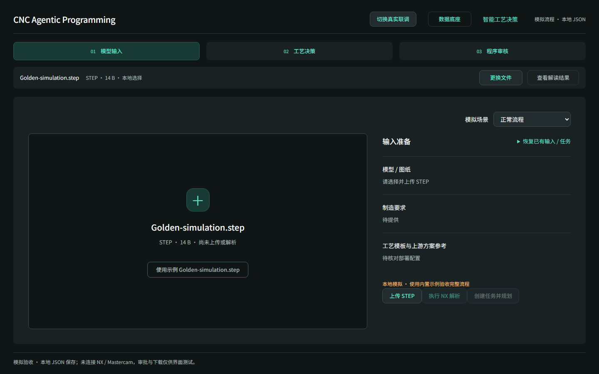
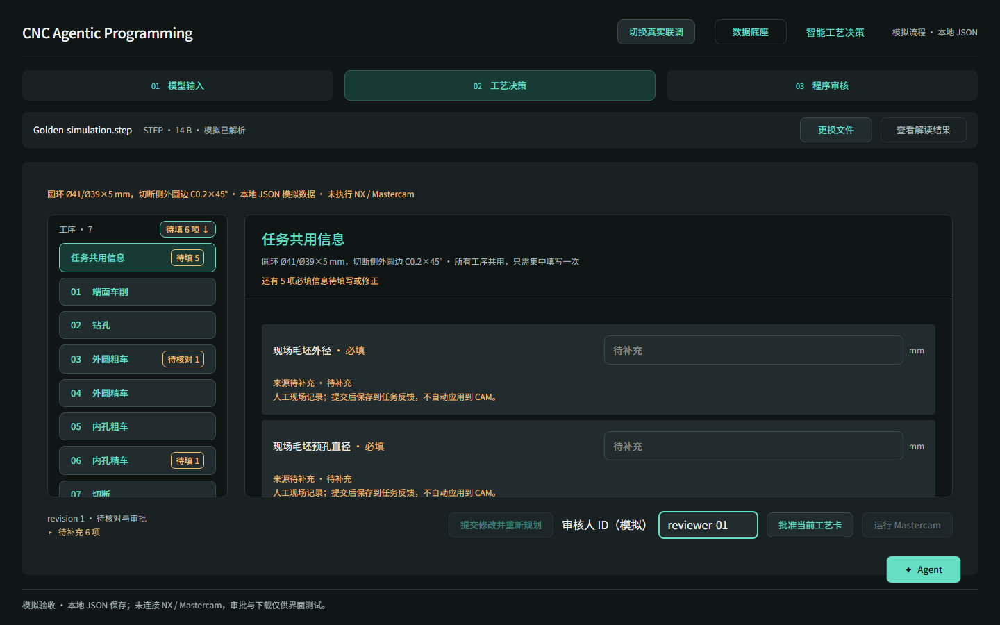
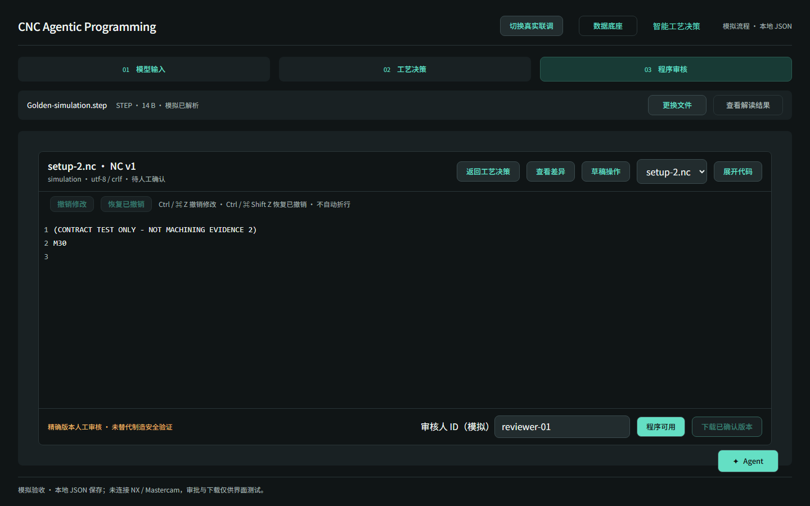

# 已确认 UI 基线

确认日期：2026-10-27。维护者已完成 main 的人工视觉确认。

- 基线提交：`b0c4e349cfef1e85e9496941d4a0594abf7a6879`（PR #35）。
- 该提交与测试分支 `ab6366d` 的代码树一致，包含 PR #33、#34；不包含已关闭且未合并的 PR #32。
- 基线覆盖模型输入、工艺决策和程序审核的真实/本地 JSON 模拟共用界面；不代表 NX、Mastercam 或加工安全验证。

## 固定的交互与布局

顶部三阶段导航承担页面标题职责，正文不重复展示阶段大标题。任务共用信息位于左侧工序列表首项，顶部合计待填字段并提供定位。参数状态标记放在对应工序按钮右侧；数值参数直接输入，统一通过“提交修改并重新规划”提交。

程序审核正文直接支持本地编辑、差异查看、撤销与草稿操作。“返回工艺决策”位于代码框工具栏；正文上方不重复堆叠任务 ID、运行 ID、模拟说明或版本状态。确认入口为“程序可用”，使用深色居中简洁对话框。版本、来源及本地草稿状态仍按实际数据展示，不把本地编辑当作服务端新 NC。

保持字号、信息密度、左选右看与局部滚动。真实与模拟流程共用界面；真实接口失败不得回退模拟。新功能若需要布局改变，应先获得维护者明确要求，再在 1920×1080 和 1440×900 两个视口复核并更新人工验收记录。

## 当前截图与历史证据

两个尺寸分别位于 `docs/api/simulation-evidence/chromium-1920x1080/` 和 `chromium-1440x900/`：

- `compact-input.png`：精简后的模型输入页。
- `compact-planning-reviewer.png`：精简后的工艺决策和统一侧栏。
- `nc-toolbar-compact.png`：最终 NC 审核布局。

其余验收文件是历史阶段证据，不能据此恢复已删除的重复提示或旧布局。本次整理仅更新文档并清理未引用的过渡截图，不修改业务代码。

## 分支与目录维护

从 main 创建短期分支，通过 PR 合回 main。确认提交已在 main、没有开放 PR 且未被工作树占用后，删除完成使命的开发分支。仍被工作树占用的分支暂保留；未合并提交不得仅因 PR 关闭而删除。

保留源代码、锁文件、具名合成 Fixture、契约、测试和历史验收记录。`node_modules/`、`dist/`、`test-results/`、`playwright-report/`、本地环境配置均不提交；本地配置和私有制造文件不能当作垃圾删除。仓库外的验收报告和其他项目工作树不属于本次清理范围。
